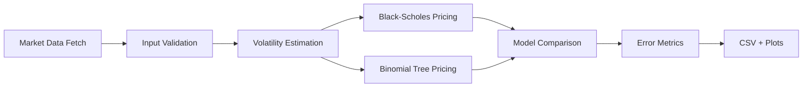

# Finsearch-24

Option-pricing comparison and valuation analysis for Black–Scholes and binomial models.

## Overview

This repository compares two widely used approaches for pricing equity options:

- Black–Scholes model for European options
- Cox–Ross–Rubinstein (CRR) binomial tree model

The project fetches option-chain data for a selected ticker, estimates the key market inputs (spot price, volatility, and risk-free rate), prices each option using both models, and compares the valuations against observed market prices.

The code is structured as a small quantitative-finance package rather than a single notebook-only workflow, making it easier to run, validate, and extend.

## Motivation and problem statement

Option pricing is one of the foundational problems in quantitative finance. Different models make different assumptions about the underlying stochastic process, time dynamics, and early-exercise behavior.

This project is intended to:

- demonstrate how option prices are computed from market inputs
- compare the approximation quality of the Black–Scholes and binomial approaches
- provide a reproducible numerical-finance workflow
- highlight the importance of model assumptions and input estimation quality

This repository is educational and analytical rather than a production trading system. It does not claim to produce investment recommendations or predictive trading signals.

## Key features

- Yahoo Finance option-chain ingestion
- robust market-data validation and fallback handling
- Black–Scholes pricing for European call/put options
- CRR binomial tree pricing for European and American-style exercise logic
- time-to-maturity and volatility estimation from real market data
- comparison against observed `lastPrice` values
- CSV artifact export and plot generation
- pytest-based regression checks for model correctness

## Methodology and technical approach

### Black–Scholes model

For a European option, the Black–Scholes price is computed using standard closed-form formulas.

For a call option:

$$
C = S\Phi(d_1) - Ke^{-rT}\Phi(d_2)
$$

where

$$
d_1 = \frac{\ln(S/K) + (r + \sigma^2/2)T}{\sigma\sqrt{T}}, \quad
 d_2 = d_1 - \sigma\sqrt{T}
$$

and $\Phi(\cdot)$ is the standard normal cumulative distribution function.

The project also supports the equivalent put price formulation.

### Binomial tree model

The CRR model discretizes the stock path into a recombining binomial tree:

$$
u = e^{\sigma\sqrt{\Delta t}}, \quad d = e^{-\sigma\sqrt{\Delta t}}
$$

$$
p_u = \frac{e^{r\Delta t} - d}{u - d}, \quad p_d = 1 - p_u
$$

At each node, the continuation value is discounted and the terminal payoff is computed from intrinsic value:

$$
V_{i,j} = e^{-r\Delta t}\left(p_u V_{i+1,j+1} + p_d V_{i+1,j}\right)
$$

For American options, the model checks the possibility of early exercise at each node:

$$
V_{i,j} = \max\left(\text{continuation}, \text{intrinsic}\right)
$$

### Model inputs

The project estimates or retrieves:

- current underlying price from Yahoo Finance
- 10-year Treasury yield as the risk-free proxy
- annualized volatility from trailing one-year returns
- option expiry and time-to-maturity from the chosen valuation date

### Evaluation methodology

For each option in the fetched chain, the project calculates:

- Black–Scholes valuation
- Binomial-tree valuation
- absolute error against market price
- mean absolute error by model

This provides a direct numerical comparison between the models under the same market assumptions.

## Project architecture

```text
Finsearch-24/
├── README.md
├── CONTRIBUTING.md
├── .env.example
├── pyproject.toml
├── requirements.txt
├── legacy/
│   └── BSvsBinomial.ipynb
├── src/
│   └── finsearch/
│       ├── __init__.py
│       ├── cli.py
│       ├── config.py
│       ├── data/
│       │   ├── __init__.py
│       │   └── market_data.py
│       ├── models/
│       │   ├── __init__.py
│       │   ├── black_scholes.py
│       │   └── binomial.py
│       ├── plotting/
│       │   ├── __init__.py
│       │   └── charts.py
│       ├── pricing/
│       │   ├── __init__.py
│       │   └── engine.py
│       └── strategy.py
├── scripts/
│   └── run_analysis.py
├── tests/
│   ├── test_pipeline.py
│   ├── test_pricing.py
│   └── test_strategy.py
└── results/
    └── generated locally; ignored by git
```

The original notebook is archived under `legacy/` and is no longer the active execution path.

### Important modules

- `src/finsearch/models/black_scholes.py`: closed-form European option price formulas
- `src/finsearch/models/binomial.py`: CRR tree implementation and exercise logic
- `src/finsearch/data/market_data.py`: Yahoo Finance access, validation, volatility estimation
- `src/finsearch/pricing/engine.py`: orchestrates batch evaluation of an option chain
- `src/finsearch/plotting/charts.py`: comparison plots and error histograms
- `src/finsearch/cli.py`: package entry point for reproducible execution

## End-to-end workflow



The execution path is:

1. Choose a ticker and expiry date.
2. Pull the option chain and spot price from Yahoo Finance.
3. Estimate volatility and risk-free rate.
4. Compute the time-to-maturity parameter.
5. Price each option using Black–Scholes and binomial models.
6. Compare model valuations against observed market prices.
7. Save results to CSV and generate comparison plots.

## Installation and setup

### Prerequisites

- Python 3.9+
- pip
- internet access for Yahoo Finance data retrieval

### Install dependencies

```bash
python -m pip install -r requirements.txt
```

Or install the project in editable mode:

```bash
python -m pip install -e .
```

## Usage and reproduction

### Run the option-pricing workflow

```bash
python -m finsearch.cli --ticker AAPL --date 2024-09-20 --option-type calls --steps 200 --output-dir results
```

### Generate a ranked strategy output

```bash
python -m finsearch.cli --ticker AAPL --date 2024-09-20 --option-type calls --steps 200 --strategy --strategy-threshold 0.05 --strategy-top-n 10 --output-dir results
```

This writes the ranked trade candidates to `results/trade_candidates.csv` and prints the top opportunities in the terminal.

### Run the analysis script

```bash
python scripts/run_analysis.py --ticker AAPL --date 2024-09-20 --option-type calls --steps 200 --output-dir results
```

### Run the test suite

```bash
python -m pytest -q
```

### Expected outputs

The workflow creates:

- `results/option_chain_evaluation.csv`
- `results/model_comparison.png`
- `results/error_distribution.png`
- `results/trade_candidates.csv` when `--strategy` is enabled

These artifacts capture the option-chain valuation comparison, the error distribution, and the ranked strategy output.

## Experiments and results

This repository is designed to compare model prices across real options data for a selected contract series. The exact numerical results depend on the market state at execution time, because the script fetches live values from Yahoo Finance.

The project does not claim a universal performance superiority of one model over the other. Instead, it provides a reproducible method for evaluating the two approaches under a specific market regime.

### Verified checks

The project includes regression tests that validate the numerical correctness of the option-pricing formulas and their behavior under normal input ranges.

The current fresh verification result is:

```text
7 passed in 6.72s
```

## Limitations and future improvements

This implementation is intentionally lightweight and has important constraints:

- it relies on Yahoo Finance for market inputs
- the volatility estimate is a simplified trailing-return approximation
- the risk-free-rate proxy is a 10-year Treasury yield, which is a rough but common approximation
- the analysis is per option chain and not a full parameter-search framework
- no advanced Greeks, implied-volatility surface estimation, or calibration workflow is included

Potential extensions include:

- dividend-adjusted Black–Scholes pricing
- probabilistic calibration of volatility surface
- Monte Carlo benchmarking against closed-form and tree models
- more formal model-selection or error analysis across multiple tickers and expiries
- richer reporting such as RMSE, MAE, and per-strike pricing summaries

## Technologies used

- Python 3.9+
- NumPy
- pandas
- SciPy
- Matplotlib
- yfinance
- pytest

## References and acknowledgments

- Black, F. and Scholes, M. (1973). The Pricing of Options and Corporate Liabilities.
- Cox, J. C., Ross, S. A., and Rubinstein, M. (1979). Option Pricing: A Simplified Approach.
- Yahoo Finance market data API for option-chain and price ingestion.
- Python scientific stack for numerical computation and visualization.

## Repository purpose summary

This project serves as a compact, reproducible option-pricing comparison repository for educational and analytical use. It is not a trading system and should not be interpreted as financial advice or a production risk-management tool.
